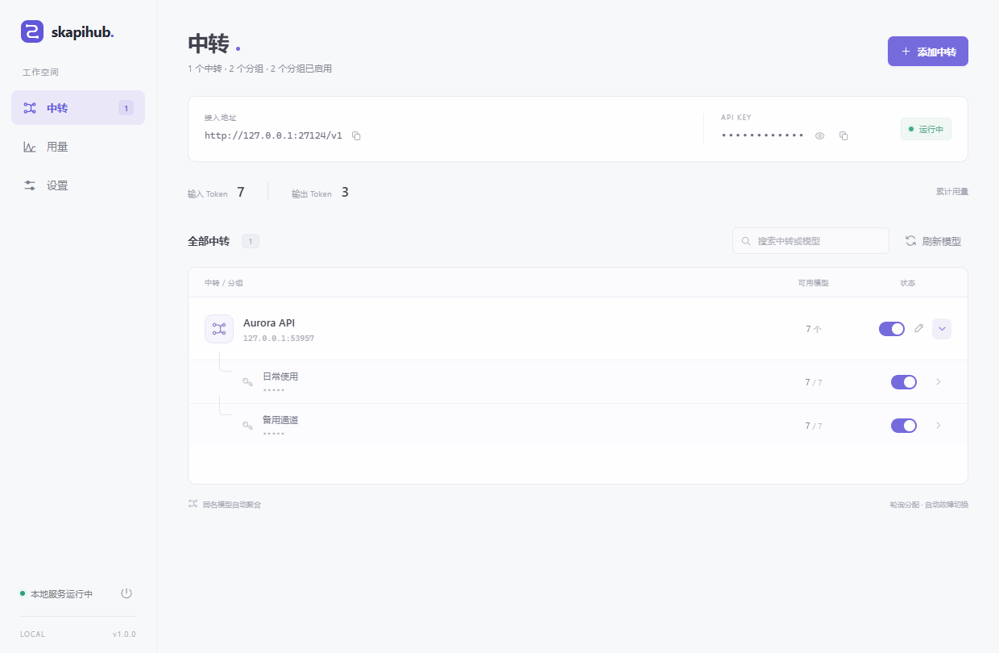

<div align="center">
  
  <h1>skapihub</h1>
  <p>轻量的 Windows AI API 聚合中转工具</p>
  <p><a href="https://github.com/yxxawa/skapihub/releases/latest">下载</a> · <a href="#快速开始">快速开始</a> · <a href="#构建">构建</a></p>
</div>

将多个中转站和 API Key 汇合为一个本地地址。使用 C# / .NET 10 与系统 WebView2，启动直接进入管理页，无需登录。



## 功能

- 添加多个中转 URL，每个 Key 对应一个独立分组，支持批量填入。
- 中转、分组、模型三级开关，默认收起分组。
- 按 Key 获取模型，同名模型自动聚合、轮询分配，响应开始前自动故障切换。
- 统一的本地 Base URL 和自定义接入 Key。
- 原协议 JSON / SSE 转发，支持 Chat、Responses、Claude Messages、Embeddings 等接口。
- 最近请求显示真实首字延迟和上游报告的 Token 用量，不估算费用。
- 关闭窗口隐藏到托盘，后台继续提供 API 服务。
- 本机加密保存 Key，不保存对话正文。

## 下载与运行要求

从 [Releases](https://github.com/yxxawa/skapihub/releases/latest) 下载与你的架构对应的 **单个 EXE**，直接运行，无需解压或复制其他文件。

| 文件 | 适用架构 |
| --- | --- |
| `skapihub-v1.0.0-windows-x64.exe` | Intel / AMD 64 位 Windows |
| `skapihub-v1.0.0-windows-arm64.exe` | ARM64 Windows |
| `skapihub-v1.0.0-windows-x86.exe` | x86 进程；也可在支持 x86 的 64 位 Windows 上运行 |

运行环境：

- Windows 10 / 11。
- [.NET 10 Desktop Runtime](https://dotnet.microsoft.com/download/dotnet/10.0) 与 **ASP.NET Core Runtime 10**，架构须与所下载的 EXE 一致。
- [Microsoft Edge WebView2 Evergreen Runtime](https://developer.microsoft.com/microsoft-edge/webview2/)。

**EXE 不包含 .NET 或 WebView2 浏览器运行时。** 网页资源、应用程序集和 WebView2 加载组件均封装在 EXE 内。首次启动时，.NET 单文件机制会把必要组件解包到用户临时目录；配置和统计另外保存到本机数据目录。

程序未做代码签名。源代码、构建脚本和发布工作流均可在本仓库查看。

## 快速开始

1. 运行 EXE，点击「添加中转」。
2. 填写中转名称、URL 和 API Key。多个 Key 可以逐个添加，也可以批量粘贴。
3. 等待模型获取完成；按需要启用或关闭分组及模型。
4. 在客户端填写：

   ```text
   Base URL: http://127.0.0.1:27123/v1
   API Key:  sk-local
   ```

接入 Key 可以在「设置」中自行修改，没有前缀或长度要求，修改立即生效。留空表示本机 API 不校验 Key。端口修改后需要重新启动。

URL 可填写站点根地址、子路径，或以 `/v1` 等版本号结尾的地址。获取模型失败时保留已有模型及开关，也支持手动添加模型 ID。

## 托盘操作

- 点击关闭按钮或按 `Alt+F4`：隐藏窗口，API 在后台继续运行。
- 双击托盘图标或右键选择「显示主界面」：恢复窗口。
- 右键选择「退出 skapihub」：停止 API、保存统计并退出。
- 隐藏后再次启动程序：恢复已有窗口，不重复启动服务。

## 接口

| 方法 | 路径 |
| --- | --- |
| GET | `/v1/models` |
| POST | `/v1/chat/completions` |
| POST | `/v1/responses`、`/v1/responses/compact` |
| POST | `/v1/messages`、`/v1/messages/count_tokens` |
| POST | `/v1/embeddings`、`/v1/completions` |
| POST | `/v1/rerank`、`/v1/images/generations` |

客户端和上游需要使用相同协议。程序不做 Chat / Responses / Messages 之间的格式转换，不提供文件上传、WebSocket 或客户端配置写入。

## 统计

- **首字延迟**只显示在「用量 → 最近请求」：从请求进入到收到第一个有效文本、思考内容或工具调用增量，包含故障切换等待时间，跳过心跳与仅含角色的事件。
- 非流式、没有有效内容或向量请求无法提供真实首字时间，显示「暂无」。
- **Token**只读取上游实际 `usage`，兼容常见 Chat、Responses 和 Claude 格式；上游未报告时显示「未知」。
- Chat 流默认请求 `include_usage`；上游明确拒绝时，用原请求回退。客户端显式关闭时保持原值。
- 一次客户端请求只记录一条明细。响应开始后不会重新发送请求。
- 保留最近 300 条请求、90 天每日汇总和累计汇总。

## 本机数据

默认目录：`%LOCALAPPDATA%\skapihub`，可以在设置中打开。

| 内容 | 用途 |
| --- | --- |
| `settings.dat` | 使用 Windows DPAPI 加密的中转、Key 与开关配置，绑定当前 Windows 用户 |
| `usage.json` | 请求明细和用量汇总 |
| `webview/` | 系统 WebView2 用户数据 |

可通过 `SKAPIHUB_DATA_DIR` 环境变量指定独立数据目录。

服务仅监听 `127.0.0.1`。管理会话由桌面程序自动建立，统一 API Key 不能修改管理配置。对话请求与响应正文不落盘。

## 构建

需要 Windows 与 [.NET 10 SDK](https://dotnet.microsoft.com/download/dotnet/10.0)。运行和构建应用不需要 Node.js。

```powershell
dotnet build Skapihub.slnx -c Release
dotnet run --project src/Skapihub.Desktop -c Release
```

生成三个架构的单 EXE：

```powershell
powershell -ExecutionPolicy Bypass -File scripts/publish.ps1
```

只生成一种架构：

```powershell
powershell -ExecutionPolicy Bypass -File scripts/publish.ps1 -Runtime win-arm64
```

结果位于 `artifacts/release/v1.0.0/`。发布使用 framework-dependent 单文件模式，显式设置 `SelfContained=false`，不携带 .NET Runtime。前端与许可证均从程序集内嵌资源读取。

## 验证

```powershell
dotnet run --project tests/Skapihub.IntegrationTests -c Release
dotnet run --project tests/Skapihub.DesktopChecks -c DesktopChecks
```

检查使用隔离数据、本地模拟上游与模拟 Key，不调用真实付费模型。

可选的浏览器检查需要 Node.js / npm：在一个终端运行 `dotnet run --project tests/Skapihub.IntegrationTests -c UiTesting -- --serve-ui`，另一个终端运行 `powershell -ExecutionPolicy Bypass -File scripts/verify-ui.ps1`。

## 开源许可

本项目使用 [MIT License](LICENSE)。聚合转发思路参考 [Metapi](https://github.com/cita-777/metapi)，相关声明见 [THIRD-PARTY-NOTICES.txt](THIRD-PARTY-NOTICES.txt)。WebView2 SDK 许可见 [licenses](licenses)，也可以在程序设置中查看内嵌的开源许可。
