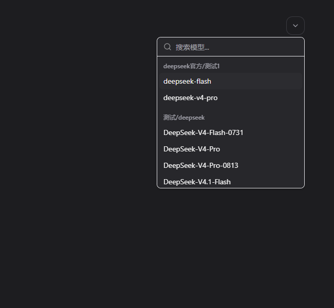

# CC Switch 模型分组显示

适用源码：`farion1231/cc-switch` 的 `v3.20.4`，提交 `43e1d99084ed9b2f5dc252fd35c5adaf29d6876e`。原项目使用 [MIT 许可证](LICENSE)。

该版本从 `/v1/models` 读取 `id` 与 `owned_by`，以 `owned_by` 显示灰色分组标题，模型行直接显示 `id`，不会读取 `name` 或 `display_name`。因此，仅修改 skapihub 的显示名字段不能改变 CC Switch 的模型行。

补丁只调整 CC Switch 下拉框的文本：当 ID 的中转、分组部分与 `ownedBy` 对应时，隐藏模型行里重复的前缀，保留上游模型名（包括模型名本身的斜线）。分组标题、选项值、选择回调和搜索均保留完整分组信息，同名模型仍独立调用。支持名称转义与重名分组后缀。



在对应 CC Switch 源码目录应用：

```powershell
git apply --check /path/to/model-group-labels-v3.20.4.patch
git apply /path/to/model-group-labels-v3.20.4.patch
pnpm install --frozen-lockfile
pnpm exec vitest run tests/components/ModelDropdown.test.tsx
pnpm exec tsc --noEmit
pnpm tauri build --no-bundle
```

修改版和官方版使用相同的数据格式。运行修改版之前需从托盘退出原 CC Switch，避免单实例机制唤起旧进程。

验证：原下拉框测试及新增的分组标题、同名选择、分组搜索、斜线模型名、名称转义测试通过；Claude 与 OpenCode 表单相关测试共 33 项通过。使用实际 `ModelDropdown` 组件进行浏览器检查，确认分组标题可见、模型行仅显示原名，选择回调仍返回完整 ID。
